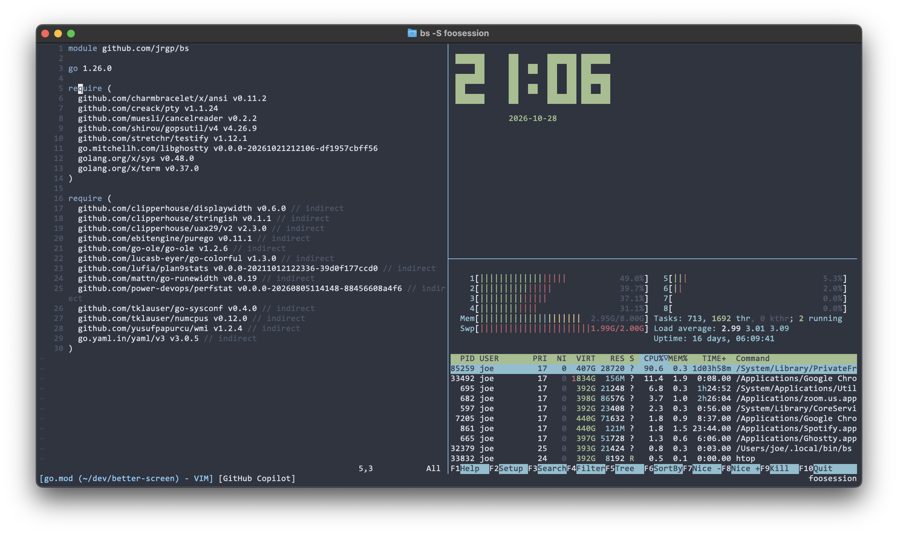

# bs - Better Screen

[](https://github.com/jrgp/better-screen/actions/workflows/release.yml)

> "What terminal multiplexer is that?"\
> "It's B-S"\
> "It's bullsh-?"\
> "No, it's Better Screen"

A GNU Screen-style terminal multiplexer for Linux and macOS. Keep shells and
full-screen programs running across SSH disconnects, with familiar Ctrl-A keys.



## Why

I've used GNU Screen every day for the past 20 years. My workflow is always to have one screen session per project/repo, with the first window used for vim and the subsequent windows used for shells. 

I wanted a few more features, such as broadcast mode and the ability to switch between sessions without detaching and reattaching, and I never had any interest in learning tmux.

With the newly released self-contained libghostty VT core, and the ability to leverage AI to rapidly make arbitrary ideas come to life, I decided to guide GPT-6.1 Sol to build a screen-alike program for explicitly my workflow, leaving out all functionality I don't use like rs232 support and vbell.

I chose Go because it's the statically-compiled language I know best and am most comfortable code reviewing en-masse (like I do at my day job), and because it had readymade standalone bindings for libghostty. This allows single-file compiled distribution. 

## Features

* Named sessions and numbered windows
* Nested horizontal/vertical splits and independent shells in each pane.
* Multi-attach with shared window selection, layouts and pane focus.
* Launch commands in separate panes and toggle per-window input broadcasting.
* Interactive session/window switchers and client-specific scrollback.
* Reliable reattachment to Vim, less and htop, with colors and Unicode intact.
* An optional templated status line showing application titles and the session.

## Install

BS is distributed as a single-file Go binary linked only against libc.

### Linux amd64

```sh
mkdir -p "$HOME/.local/bin" &&
curl -fL https://github.com/jrgp/better-screen/releases/latest/download/bs-linux-amd64 -o "$HOME/.local/bin/bs.new" &&
chmod 755 "$HOME/.local/bin/bs.new" &&
mv -f "$HOME/.local/bin/bs.new" "$HOME/.local/bin/bs" &&
export PATH="$HOME/.local/bin:$PATH" &&
bs -v
```

### macOS arm64 (Apple Silicon)

```sh
mkdir -p "$HOME/.local/bin" &&
curl -fL https://github.com/jrgp/better-screen/releases/latest/download/bs-darwin-arm64 -o "$HOME/.local/bin/bs.new" &&
chmod 755 "$HOME/.local/bin/bs.new" &&
mv -f "$HOME/.local/bin/bs.new" "$HOME/.local/bin/bs" &&
export PATH="$HOME/.local/bin:$PATH" &&
bs -v
```

Add `~/.local/bin` to your shell's startup PATH to keep `bs` available in future
terminals. Existing sessions keep their current daemon until they finish.

## Usage

```sh
bs                   # create and attach a new session
bs -S work           # create a named session
bs -ls               # list sessions
bs -r work           # reattach to a detached session
bs -x work           # attach alongside other clients
bs -x                # attach when exactly one session exists
bs -d -r work        # detach other clients and reattach
bs -v                # print version
```

Unambiguous session-name prefixes work. Detaching leaves programs running.
Exiting the final pane closes its window; the final window closes its session.
bs restores your terminal and prints `[bs: detached from session work]` on
detach, or `[bs: session work exited]` when the session ends.
New windows and panes start in the session's original working directory,
falling back to `$HOME` if it no longer exists.

Launch several commands in one window:

```sh
bs -S production --panes "ssh web-01" "ssh web-02" "ssh web-03"
```

Each argument after `--panes` runs through `$SHELL -c` in its own PTY, with no
extra default shell. Put `-S` before `--panes`; attach/list/version options cannot
be combined with it. Panes form a balanced grid (four commands make a 2x2 grid),
with horizontal and vertical splits, and disappear when their commands exit.
Up to 32 commands are supported, provided the terminal can fit them; impossible
layouts are rejected before launching anything.

### Keys

Press **Ctrl-A**, then a key below. You can keep Ctrl held when pressing Space
to switch windows.

| Key | Action |
|---|---|
| `c` | Create window |
| `n` / `Space` | Next window |
| `p` | Previous window |
| `Left` / `Right` | Move current window left/right and renumber windows |
| `0`-`9` | Select numbered window |
| `"` | Window list |
| `s` | Session switcher |
| `\|` / `S` | Split left/right / top/bottom |
| `=` | Equalize pane widths and heights |
| `Tab` / `Shift-Tab` | Next / previous pane |
| `K` | Kill focused pane |
| `k` | Kill whole window |
| `Esc` | Scrollback |
| `F` | Fit session to this terminal |
| `R` | Reload configuration for all sessions |
| `B` | Toggle input broadcast to every pane in this window |
| `d` | Detach this client |
| `a` | Send literal Ctrl-A |
| `?` | Help |

Menus use arrow keys, Enter to select and Esc to cancel. Session switching
affects only your client; window selection and pane focus are shared.
Reordering keeps the same window selected and wraps around at either end of the list.
Scrollback uses Up/Down and Page Up/Page Down (or Ctrl-U/Ctrl-D); Esc returns to live output.
Text selection and clipboard copying are not implemented.

Broadcast is off by default. When enabled, normal input (including Enter,
control characters and escape sequences) goes to every pane, including newly
created panes. Ctrl-A commands still act normally and are not broadcast.
The toggle belongs to the window, is shared by attached clients and survives
window switching; disabling it restores focused-pane input.

The first client sets session dimensions; additional clients do not resize it.
Use Ctrl-A F to fit explicitly. Very small terminals temporarily show only the
focused pane; fitting a larger terminal restores the layout.
Ctrl-A `=` balances both dimensions within the existing split arrangement,
preserving pane order, focus and processes. Equal proportions are maintained
when the window is resized.

### Status line

The status line is enabled by default. To disable it, put this in
`~/.bs/config.json`:

```json
{"status_line": false}
```

The default shows `[title]` for each window on the left, or
`[Broadcast | title]` when that window has broadcast enabled, and the session
name on the right. Titles come from applications (OSC 0/2), with the shell name
as a fallback; a split window shows its focused pane's title.

Customize the three sections with Go templates. For example, center the session
name while keeping the default left section:

```json
{
  "status_line_center": "{{ .Session.Name }}",
  "status_line_right": ""
}
```

`status_line_left`, `status_line_center` and `status_line_right` receive
`.Windows` (`.Number`, `.Title`, `.Active`, `.Broadcast`) and `.Session` (`.Name`, `.ID`).
Use `{{ highlight "text" }}` for active-window styling. Missing keys use defaults;
empty strings render nothing. Center text clips first on overlap, then left;
right text has priority. Terminal control sequences are stripped.
Custom templates can use `{{ if .Broadcast }}Broadcast | {{ end }}` inside a
window loop to display the broadcast state.

Configuration loads when the daemon starts. After editing it, press **Ctrl-A R**
(uppercase R) to reload it for all sessions without restarting. Invalid
configuration leaves the previous settings in place and shows an error.

Colors accept HTML hex RGB (`#RRGGBB` or `#RGB`, case-insensitive):

```json
{
  "border_color": "#87cefa",
  "status_active_tab_color": "#87cefa",
  "status_active_tab_bg": ""
}
```

These are the defaults: accent-colored pane borders and active-tab text, with
no active-tab background. Set `status_active_tab_bg` to a hex color to fill the
active tab, or `""` to clear it. For white text on the accent background, use
`"status_active_tab_color": "#ffffff"` and `"status_active_tab_bg": "#87cefa"`.
Set `status_active_tab_color` to `""` to leave the foreground unchanged; omitting
the key still uses the default accent color.

For example, a Nord-like theme:

```json
{
  "border_color": "#4c566a",
  "status_active_tab_color": "#81a1c1"
}
```

Ctrl-A R applies color changes immediately to all attached clients.

### Build and release

```sh
make build           # build ./bs from source
make release         # increment the latest stable patch tag and push it
```

See [ARCHITECTURE.md](ARCHITECTURE.md) for build prerequisites, internals,
testing and release details, and [AGENTS.md](AGENTS.md) for contributor guidance.
